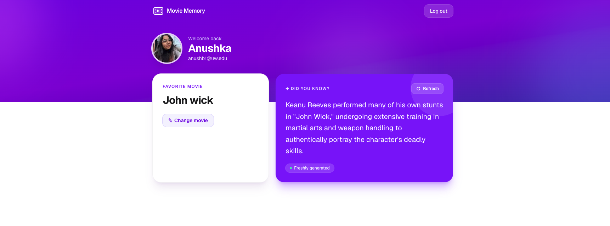
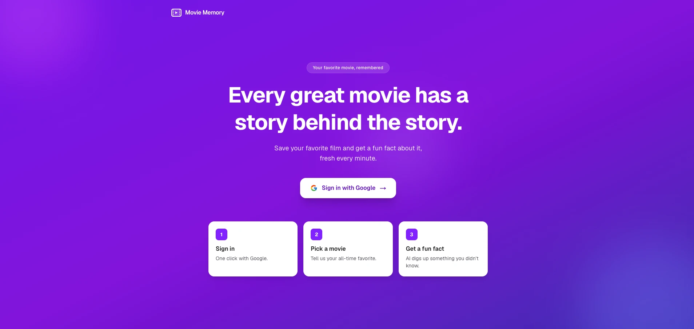
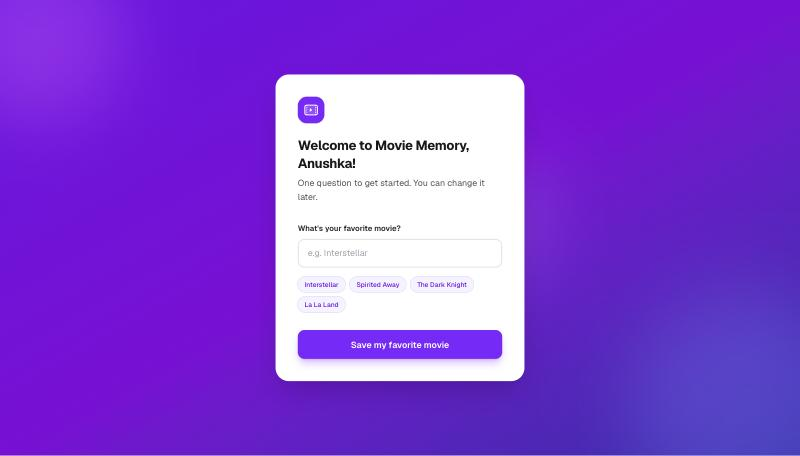
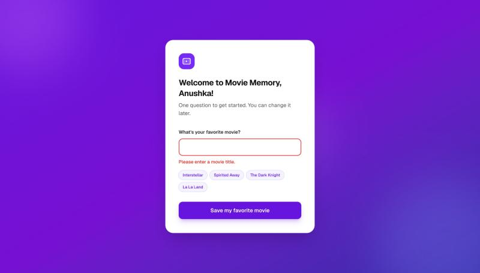
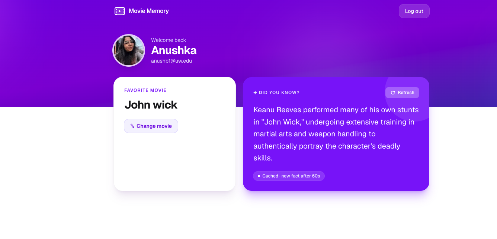
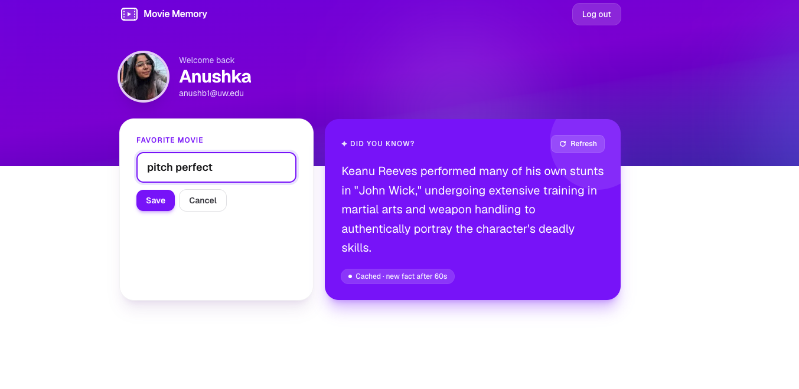
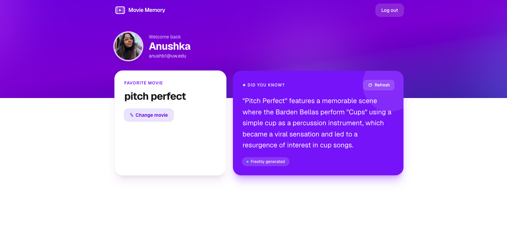
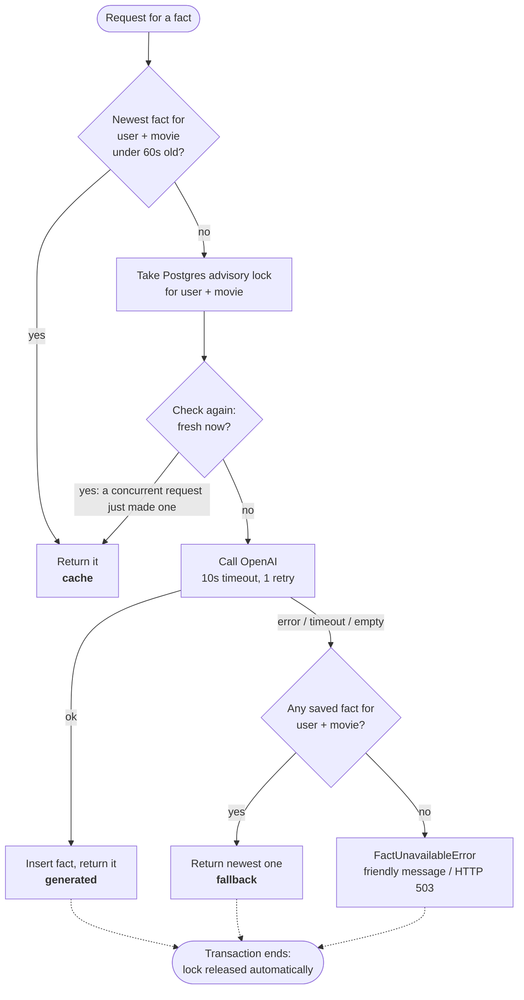
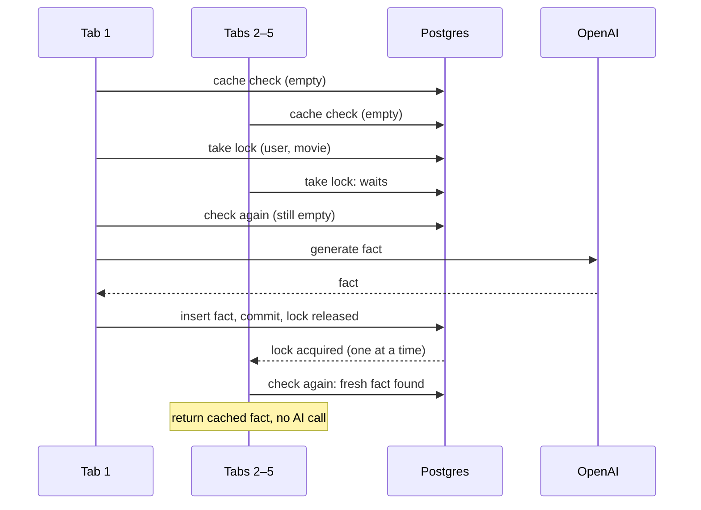

# Movie Memory

Sign in with Google, save your favorite movie, and get an AI-generated fun fact about it.

**Stack:** TypeScript · Next.js 15 (App Router) · React 19 · Tailwind CSS 4 · Postgres · Prisma 6 · Auth.js (Google OAuth) · OpenAI API · Vitest

**Variant chosen: A (Backend: caching & correctness).** See [Why Variant A](#why-variant-a).



---

## Contents

1. [Requirements walkthrough](#requirements-walkthrough) (every requirement in the brief, with proof)
2. [Edge cases handled](#edge-cases-handled)
3. [Setup](#setup)
4. [Environment variables](#environment-variables)
5. [Database & migrations](#database--migrations)
6. [Running tests](#running-tests)
7. [Architecture overview](#architecture-overview)
8. [Variant A: how fact caching works](#variant-a-how-fact-caching-works)
9. [Why Variant A](#why-variant-a)
10. [Key tradeoffs](#key-tradeoffs)
11. [With 2 more hours](#with-2-more-hours)
12. [AI usage](#ai-usage)

---

## Requirements walkthrough

Each requirement from the brief, where it's implemented, and how it's verified.

### 1. Authentication

> *Visiting `/` while unauthenticated shows a landing page with "Sign in with Google". After login, first-time users go to onboarding; returning users go to the dashboard.*



| | |
|---|---|
| **Where** | [`src/app/page.tsx`](src/app/page.tsx) (landing), [`src/auth.ts`](src/auth.ts) (Auth.js + Google), [`src/lib/session.ts`](src/lib/session.ts) (`homeFor`) |
| **How** | After Google redirects back, `homeFor(user)` routes on *"does this user have a favorite movie?"*: no → `/onboarding`, yes → `/dashboard`. A user who signed in but abandoned onboarding is correctly sent back to it. |
| **Logged-out guard** | `/dashboard` and `/onboarding` call `getCurrentUser()` server-side and `redirect("/")` when there's no session. |

### 2. Onboarding (first time only)

> *Prompt for favorite movie. Server-side validation (trim, min/max length). Store in Postgres, associated with the user.*

| First visit | Submitting only spaces |
|---|---|
|  |  |

| | |
|---|---|
| **Where** | [`src/app/onboarding/actions.ts`](src/app/onboarding/actions.ts) (server action), [`src/lib/validation.ts`](src/lib/validation.ts) (`movieSchema`) |
| **Validation** | Trim, collapse inner whitespace, then require 1–100 characters, all on the server. The input's `maxLength` is only a UX hint. |
| **First-time only** | The page redirects users who already have a movie, and the write is `updateMany({ where: { id, favoriteMovie: null } })`, so even a replayed request can't overwrite a movie via onboarding. |
| **Tests** | [`validation.test.ts`](src/lib/__tests__/validation.test.ts): trimming, empty, whitespace-only, missing field, 100 vs 101 chars. |

### 3. Dashboard

> *Show name, email, photo (if available), favorite movie (from DB), and a logout button.*


| | |
|---|---|
| **Where** | [`src/app/dashboard/page.tsx`](src/app/dashboard/page.tsx) |
| **Missing name/photo** | No photo → initial-letter avatar; no name → falls back to email, then "Movie fan". |
| **Logout** | Server action calling `signOut()`, which deletes the `Session` row (server-side revocation) and clears the cookie. |

### 4. Fact generation (base) and Variant A cache

> *Display a fun fact using OpenAI and store generated facts. Variant A: reuse a fact under 60 seconds old, otherwise generate a new one.*

| Right after generating | Refreshing within 60s: served from cache |
|---|---|
|  |  |

The pill under each fact shows which path served it: **Freshly generated**, **Cached · new fact after 60s**, or **AI unavailable · showing your latest fact**. The **Refresh** button asks the server again; the server alone decides whether to reuse or regenerate.

| | |
|---|---|
| **Where** | [`src/lib/facts.ts`](src/lib/facts.ts) (`getOrCreateFact`), [`src/app/dashboard/FunFact.tsx`](src/app/dashboard/FunFact.tsx), [`src/app/api/fact/route.ts`](src/app/api/fact/route.ts) |
| **Storage** | Every fact is a `Fact` row with `userId`, `movie`, `content`, `createdAt`. |
| **Tests** | [`facts.test.ts`](src/lib/__tests__/facts.test.ts): fresh at 59.999s, stale at exactly 60s; reuse under 60s; regenerate after; movie change = cache miss. |

### 5. Variant A: burst / idempotency protection

> *Prevent multiple new facts from being generated simultaneously (quick refreshes, multiple tabs).*

| | |
|---|---|
| **Approach** | DB transaction guard: a Postgres advisory lock per `(user, movie)` plus a second cache check inside the lock (see [diagram](#variant-a-how-fact-caching-works)). |
| **Proof** | Test fires 5 simultaneous requests at a deliberately slow mocked model → exactly **1** model call and **1** stored fact. Removing the lock makes this test fail with 5 calls. |
| **Live check** | 5 parallel `curl` requests to `GET /api/fact` → 1 `generated` + 4 `cache`, 1 row in the database. |

### 6. Variant A: failure handling

> *If OpenAI fails, return the most recent cached fact if one exists, otherwise a user-friendly error.*

| | |
|---|---|
| **Where** | `getOrCreateFact` → `catch` branch; `FactUnavailableError` → HTTP 503 in the route, friendly message on the dashboard |
| **Tests** | Falls back to the newest saved fact; friendly error when none; empty model reply treated as a failure (never stored). |

### 7. Editing the movie (small extra, outside the variant)

| Editing | After saving: the cache key changed, so a new fact is generated |
|---|---|
|  |  |

Same server-side `movieSchema` as onboarding. No cache-invalidation code is needed: facts are cached per `(user, movie)`, so a new movie has no fresh fact yet.

### 8. Security & correctness (applies to all)

| Requirement | How it's met | Verified by |
|---|---|---|
| Validate movie input server-side | Shared zod schema in both server actions | `validation.test.ts`, screenshot above |
| Users can't access or modify others' data | User id only from the session; every query filtered by it; `GET /api/fact` accepts no user parameter | `facts.test.ts` + `route.test.ts` authorization tests |
| Don't expose secrets to the client | No `NEXT_PUBLIC_` variables; `import "server-only"` in `openai.ts` / `facts.ts` breaks the build if imported client-side | Build-time guarantee |
| Handle missing Google photo or name | Initial avatar, name → email → "Movie fan" fallback | Rendered with a photo-less test user |

---

## Edge cases handled

| Situation | What happens |
|---|---|
| Movie typed with extra spaces (`"  The   Matrix "`) | Stored as `The Matrix`, so it's the same cache key as a clean entry |
| Only spaces, or empty | Rejected on the server with "Please enter a movie title." |
| 101+ characters | Rejected on the server (length measured *after* trimming) |
| User signs in but closes the tab before onboarding | Next visit sends them back to onboarding, not an empty dashboard |
| Onboarding request replayed after a movie is set | No-op: the write only applies where `favoriteMovie IS NULL` |
| Logged out and visiting `/dashboard` or `/onboarding` | Redirected to `/`; `GET /api/fact` returns 401 |
| Google account with no photo or no name | Initial-letter avatar; name falls back to email |
| Refreshing within 60s / several tabs at once | One model call; the rest are served from cache |
| OpenAI timeout, error, or empty reply | Newest saved fact for this user + movie (any age); otherwise a friendly message / 503 |
| OpenAI down and only *another user* has a fact | Friendly error, never another user's fact |
| User changes their movie | Next request is a cache miss, so a fact about the new movie is generated |
| Movie title containing instructions ("ignore your rules…") | Sent only as the user message; the system prompt treats it as a title |
| Server crashes while holding the lock | Postgres releases transaction-scoped advisory locks automatically |

---

## Setup

**Requirements:** Node 20+, Postgres 14+ (tested on Postgres 16, Node 23).

```bash
# 1. Install dependencies
npm install

# 2. Create the databases (dev + a separate one for tests)
createdb movie_memory
createdb movie_memory_test

# 3. Configure environment
cp .env.example .env
#    then fill in the values (see the next section)

# 4. Create the tables
npx prisma migrate dev

# 5. Run
npm run dev
```

Open **http://localhost:3000** (use port 3000: it must match the Google redirect URI).

<details>
<summary>No Postgres installed? (macOS)</summary>

```bash
brew install postgresql@16
brew services start postgresql@16
```
</details>

### Google OAuth client

1. [Google Cloud Console](https://console.cloud.google.com/) → create a project.
2. **APIs & Services → OAuth consent screen**: External; add your Google account as a **test user**.
3. **Credentials → Create credentials → OAuth client ID → Web application**:
   - Authorized JavaScript origin: `http://localhost:3000`
   - Authorized redirect URI: `http://localhost:3000/api/auth/callback/google`
4. Copy the client ID and secret into `AUTH_GOOGLE_ID` / `AUTH_GOOGLE_SECRET`.

---

## Environment variables

| Variable | Required | Purpose |
|---|---|---|
| `DATABASE_URL` | ✅ | Postgres connection string, e.g. `postgresql://USER@localhost:5432/movie_memory` |
| `AUTH_SECRET` | ✅ | Signs/encrypts Auth.js cookies. Generate with `npx auth secret` or `openssl rand -base64 32` |
| `AUTH_GOOGLE_ID` | ✅ | Google OAuth client ID |
| `AUTH_GOOGLE_SECRET` | ✅ | Google OAuth client secret |
| `OPENAI_API_KEY` | ✅ | OpenAI API key |
| `OPENAI_MODEL` | – | Defaults to `gpt-4o-mini` |
| `OPENAI_BASE_URL` | – | Point the OpenAI SDK at an OpenAI-compatible provider. Leave empty for OpenAI |
| `DATABASE_URL_TEST` | – | Test DB. Defaults to `postgresql://$USER@localhost:5432/movie_memory_test` |

None of these use the `NEXT_PUBLIC_` prefix, so none are ever sent to the browser.

---

## Database & migrations

```bash
npx prisma migrate dev      # apply migrations in development (creates the DB schema)
npx prisma migrate deploy   # apply existing migrations without prompting (CI / prod)
npx prisma studio           # browse/edit data in a local UI
```

Migrations live in `prisma/migrations/`. The test suite runs `prisma migrate deploy` against the **test** database automatically before running.

---

## Running tests

```bash
npm test
```

23 tests run against the separate `movie_memory_test` database with OpenAI mocked (no network calls, no cost):

| Area | What's covered |
|---|---|
| 60-second cache | Fresh at 59.999s, stale at exactly 60s; reuse under 60s; regenerate after; movie change = cache miss |
| Burst protection | 5 concurrent requests → **1** OpenAI call and **1** stored fact |
| Failure handling | Falls back to newest saved fact; friendly error when none; empty AI reply treated as failure |
| Authorization | A user never receives another user's fact (fresh, same movie, or as a fallback); `GET /api/fact` returns 401 / 409 / 503 correctly and exposes no ids |
| Validation | Trim + whitespace collapse, empty/whitespace-only rejected, length bounds measured after trimming |

To confirm the burst test is meaningful, I removed the advisory lock and re-ran it: it failed with *"expected 1 call, got 5"*.

---

## Architecture overview

```
Browser (React)
   │  server actions / fetch
   ▼
Next.js server (App Router)
   ├─ src/auth.ts ─────────────► Google OAuth (Auth.js + Prisma adapter)
   ├─ src/lib/session.ts        who is logged in + routing rule
   ├─ src/lib/validation.ts     one zod schema for movie input
   ├─ src/lib/facts.ts ────────► OpenAI (src/lib/openai.ts, server-only)
   └─ src/lib/prisma.ts ───────► Postgres
```

### Guiding rule
The browser is untrusted. Identity, validation and authorization are decided on the server. The user id **only** ever comes from the server-side session, never from a URL, body or query parameter.

### Request flow

1. **`/` (landing):** server component. Logged out → "Sign in with Google". Logged in → redirected by `homeFor(user)`.
2. **Sign in:** a server action calls `signIn("google")`. Google redirects back to `/api/auth/callback/google`; the Prisma adapter creates `User` + `Account` rows on first login and a `Session` row every login. The browser receives only an `httpOnly` session-token cookie.
3. **Routing rule (`homeFor`):** no session → `/`; no `favoriteMovie` → `/onboarding`; otherwise `/dashboard`. Keying on *"has a movie?"* rather than *"is a new account?"* means a user who abandoned onboarding is sent back to it. Every protected page re-checks this server-side.
4. **Onboarding:** server action → zod validation → `updateMany({ where: { id, favoriteMovie: null } })` so onboarding can set but never overwrite a movie → redirect to dashboard.
5. **Dashboard:** profile (with fallbacks for missing name/photo), movie with inline edit, fun fact, logout. The fact is an async server component inside `<Suspense>`, so the profile renders immediately and the fact streams in.
6. **Fact:** `getOrCreateFact(userId)` (see next section), also exposed as `GET /api/fact`.
7. **Edit movie:** server action with the same zod schema, then `revalidatePath("/dashboard")`.
8. **Logout:** `signOut()` deletes the `Session` row and clears the cookie.

### Data model

```
User ──< Fact
 │
 ├──< Account   (Auth.js)
 └──< Session   (Auth.js)
```

| Model | Notable fields | Why |
|---|---|---|
| `User` | `name?`, `email?`, `image?`, `favoriteMovie?` | Google may omit name/photo, so they're nullable. `favoriteMovie` lives on `User` (exactly one per user, so no join); `null` means onboarding isn't done |
| `Fact` | `userId`, `movie`, `content`, `createdAt` | `movie` is stored per fact so history stays correctly labeled after an edit, and so the cache key is `(userId, movie)` |
| `Fact` index | `@@index([userId, movie, createdAt desc])` | Exactly matches the hot query: "newest fact for this user + movie" |
| `Account`, `Session`, `VerificationToken` | standard Auth.js shape | Required by the Prisma adapter |

All relations use `onDelete: Cascade`, so deleting a user removes their facts and sessions.

### Sessions: database, not JWT
The session lives in Postgres; the cookie holds only a random token. Logging out deletes the row, so the session is revoked server-side immediately (a JWT stays valid until it expires). The cost is one DB lookup per request, which is negligible here.

### Security checklist

| Requirement | Implementation |
|---|---|
| Validate movie input server-side | Shared `movieSchema` (trim, collapse whitespace, 1–100 chars) in both server actions. The `maxLength` attribute is UX only |
| Users can't access/modify others' data | User id from session only; every query filtered by it; `GET /api/fact` accepts no user parameter; covered by tests |
| No secrets on the client | No `NEXT_PUBLIC_` vars; `import "server-only"` in `openai.ts` and `facts.ts` fails the build if imported client-side |
| Missing Google photo/name | Initial-letter avatar; name falls back to email, then "Movie fan" |
| Prompt injection via movie title | Title is sent as the user message; the system message instructs the model to treat it only as a title |

---

## Variant A: how fact caching works

`src/lib/facts.ts → getOrCreateFact(userId)`



**Five tabs at once:**



**1. 60-second window.** The `Fact` table *is* the cache: the newest row for `(userId, movie)` is the cached value and its `createdAt` is its age. `isFresh()` is a pure function (`now − createdAt < 60_000`) so the boundary is unit-tested without real waiting.

**2. Burst / idempotency protection: DB transaction guard.** Concurrent requests for the same `(user, movie)` (fast refreshes, several tabs, or several server instances) serialize on a Postgres **transaction-scoped advisory lock**. The first request generates; the others wait, then hit the **second cache check** inside the lock and return the fact the first one just stored (double-checked locking). Different users or movies hash to different locks, so they never block each other. The lock is released automatically on commit, rollback, or a dropped connection, so it can't be left stuck.

I chose this over an in-memory lock because an in-memory lock only protects a single Node process. With more than one instance (normal on Vercel or behind a load balancer) duplicates come back. Postgres is already shared by every instance.

**3. Failure handling.** The OpenAI client has a 10s timeout and 1 retry. On any failure (timeout, API error, empty reply) we return the newest saved fact for this user + movie regardless of age, labeled as a fallback; if there's none, a friendly error. The fallback query is scoped to the user, so an outage can't leak someone else's fact.

**4. Editing the movie needs no cache invalidation.** Because the cache key includes the movie, a new movie simply has no fresh fact and the next request generates one.

The dashboard shows which path served the fact ("Freshly generated", "Cached…", or "AI unavailable…").

---

## Why Variant A

I chose Variant A because it's backend-focused, and backend work is what I enjoy most.

It also targets the most interesting problem in this app: the AI call is slow, costs money, can fail, and can be triggered several times at once. Variant A is about handling exactly that (caching, concurrency, failure handling), and those guarantees can be proven with backend tests against a real database.

I did add one small extra outside the variant: a simple **inline edit** of the favorite movie (server-validated with the same schema), because it makes the cache-key design visible and testing different movies easier. Variant B's optimistic UI, typed client, and client-side cache are intentionally out of scope.

---

## Key tradeoffs

| Decision | Upside | Cost / limitation |
|---|---|---|
| Advisory lock held during the OpenAI call | Simple, correct across multiple server instances, auto-releases | A DB connection is held for up to ~20s (10s timeout + 1 retry) per generating request; under heavy concurrent generation this could exhaust the connection pool |
| `Fact` table as the cache (no Redis) | No extra infrastructure; the spec already requires storing facts | Every cache hit is a DB query (indexed, cheap at this scale) |
| Rolling 60s window via `createdAt` | Exact "less than 60 seconds" semantics | Relies on app and DB clocks agreeing (same machine here; in prod both are NTP-synced) |
| Per-user facts | Clean authorization; matches the spec | Two users with the same movie each pay for a generation |
| Database sessions | Instant server-side revocation on logout | One DB lookup per authenticated request |
| Redirects in server components, not middleware | Can read `favoriteMovie` from the DB (Prisma doesn't run in the Edge runtime) | Each protected page must call the check (centralized in `getCurrentUser` / `homeFor`) |
| Fact rendered in a server component | No client fetch code; fact streams via `<Suspense>` | The Refresh button re-renders server components (`router.refresh()`) rather than calling `/api/fact`, so the dashboard and the API share logic but not a code path |

---

## With 2 more hours

1. **Release the DB connection during generation.** Insert a `generating` placeholder row guarded by a unique `(userId, movie)` partial index, call OpenAI outside the transaction, then fill it in. This keeps the burst guarantee without holding a connection open.
2. **Shared per-movie fact pool.** A `MovieFact` table keyed by normalized title, plus per-user "seen" tracking, to cut OpenAI cost for popular movies without exposing user data.
3. **Rate limiting** per user on fact generation (beyond the 60s window) to cap spend from scripted abuse.
4. **End-to-end test** of the auth → onboarding → dashboard flow with Playwright, using a seeded session.
5. **Structured logging + metrics** for cache hit rate, generation latency, and fallback frequency.
6. **Show the fact's age** ("generated 23s ago") and a countdown until a new fact is available.
7. **CI** (GitHub Actions with a Postgres service) running lint, typecheck, and tests on every push.

---

## AI usage

- **Understanding the brief:** used ChatGPT to get an initial breakdown of the PDF, then used Claude to check that breakdown against the actual PDF. This caught missed requirements (e.g. redirecting logged-out users from `/dashboard`, the "unless user explicitly requests" detail, the exact test requirements) and weak design choices.
- **Design discussion:** talked through schema design, the onboarding routing rule ("has a movie?" vs "new account?"), session strategy, and the burst-protection options with Claude before writing code.
- **Implementation:** used Claude Code to scaffold the project and write the code stage by stage (auth → onboarding → dashboard → facts → Variant A → tests), reviewing and asking for an explanation of each file before moving on.
- **Debugging:** used Claude to diagnose a Google `redirect_uri_mismatch` (a second dev server on port 3001), a stale Next.js dev cache, and hydration warnings caused by a browser extension.
- **Testing:** AI wrote the initial test suite; I verified the burst test actually detects the bug by removing the lock and confirming it fails.
- **Verification:** every stage was checked by running the app, the typechecker, the linter, and the tests. I can explain every file and decision in this repository.
